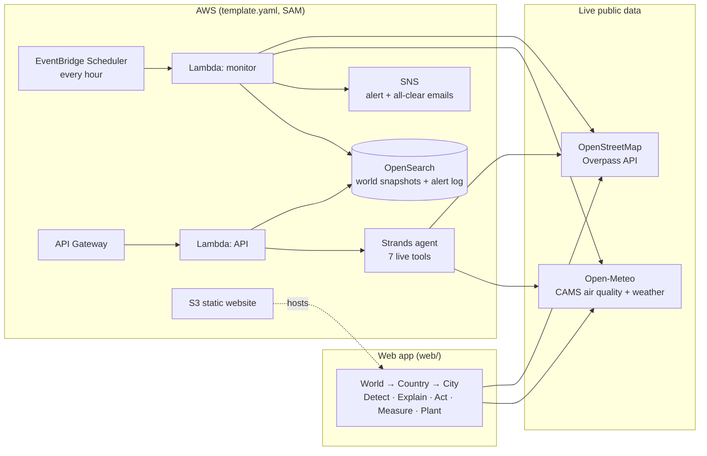

# AIR2GREEN

**Live air quality for every country on Earth: what to do on a bad-air day, and where to plant trees so it happens less.**

AIR2GREEN turns live air-pollution data into decisions. Pick any country or city and it tells
you, in plain language, whether the air is dangerous now or will be in the next 48 hours, why,
which schools and hospitals are exposed, what each of them should do, how much exposure those
actions save, and where tree planting would protect the most people over the long term.

> Built for the **Air track** of an environmental hackathon, on **AWS open-source tools**.

---

## Contents

- [The problem](#the-problem)
- [What AIR2GREEN does](#what-air2green-does)
- [Live data sources](#live-data-sources)
- [Architecture](#architecture)
- [AWS open-source tools used](#aws-open-source-tools-used)
- [Project structure](#project-structure)
- [Quick start](#quick-start)
- [Deploy on AWS](#deploy-on-aws)
- [API reference](#api-reference)
- [The Strands agent](#the-strands-agent)
- [How the numbers are calculated](#how-the-numbers-are-calculated)
- [Testing](#testing)
- [Limitations and roadmap](#limitations-and-roadmap)
- [Credits and licences](#credits-and-licences)

---

## The problem

When air pollution becomes hazardous, people and institutions can see that the air is bad,
but they can't:

1. **understand the burden**: how bad, for how long, and who is breathing it;
2. **choose a local response**: what a school, a hospital or a city official should do today;
3. **measure whether it helped**: what the response actually saved.

Most air-quality apps stop at a coloured number. AIR2GREEN closes the loop from that number
to an action and a measured result.

## What AIR2GREEN does

The app has three levels. Every level updates itself with live data every 15 minutes.

### World

- Every country coloured by PM2.5 at its capital, right now. Small countries appear as dots.
- One-line summary, for example: *"The air in 22 of 244 capitals is above the WHO guideline; 6 are at
  a level where children should move outdoor activity indoors."*
- Tabs: **Worst now**, **Getting worse in the next 24 h**, **Cleanest**.

### Country

- Every major city on a map, sized by population and coloured by air quality.
- Cities ranked by PM2.5, each with its peak over the next 24 hours.

### City: the full response, top to bottom

| Step | Question it answers | What you see |
|---|---|---|
| **Status** | How is the air right now? | Band name, PM2.5, "x times the WHO guideline", plain advice, 4-day outlook, **best 2-hour window outdoors** |
| **1. Detect** | Is the air dangerous? | Hourly chart: past 24 h plus a 3-day forecast, alert periods marked, "Alert now" or "Alert coming" with times |
| **2. Explain** | Why, and who is at risk? | Likely cause from live signals (wind, mixing height, dust share, carbon monoxide); schools, colleges, hospitals and clinics within 2 km, flagged when within 60 m of a major road |
| **3. Act** | What should we do? | Actions for schools, hospitals, everyone and city officials, scaled to severity; a "Done" tick per site |
| **4. Measure** | What does it save? | Person-hours moved indoors, % less PM2.5 breathed during the alert, sites confirmed |
| **5. Plant** | How do we make it happen less? | The five sites where planting protects the most people (Green Gap), with layout, what to avoid, species and the tree-equivalent of the local burden |

Also: search for any country or city, **My location**, a scale switch (local, US EPA or India
CPCB), and light and dark themes. It works on phones.

## Live data sources

No API keys are needed.

| Data | Source | Used for |
|---|---|---|
| PM2.5, PM10, dust, carbon monoxide: now, past 24 h, 4-day hourly forecast | [Copernicus Atmosphere Monitoring Service (CAMS)](https://atmosphere.copernicus.eu/) via the [Open-Meteo air-quality API](https://open-meteo.com/en/docs/air-quality-api) | Detect, Explain, Measure, Plant |
| Wind speed, boundary-layer (mixing) height | [Open-Meteo weather API](https://open-meteo.com/en/docs) | Likely cause, tree-equivalent |
| Schools, colleges, hospitals, clinics, major roads, parks | [OpenStreetMap](https://www.openstreetmap.org/) via the [Overpass API](https://overpass-api.de/) | Who is exposed, actions, Green Gap |
| Country shapes | [Natural Earth](https://www.naturalearthdata.com/) 1:50m via `world-atlas` (bundled) | Maps |
| Countries, capitals, about 2,000 major cities | [GeoNames](https://www.geonames.org/) (bundled) | Search, country view |

Coverage: **244 countries and territories**.

## Architecture



- The **web app** is a static site. It calls the live data APIs directly from the browser, so it
  runs anywhere, even without AWS.
- The **AWS backend** runs the same analysis in Python (`air2green/response.py` mirrors
  `web/app.js`). Every hour it saves PM2.5 for every capital to OpenSearch, analyses the cities
  you choose, and emails an alert when a bad-air period starts or is forecast within 48 hours,
  then an all-clear with the exposure estimate when it ends.
- The **Strands agent** answers questions for any city using live tools, through the API or a terminal.

## AWS open-source tools used

| Tool | Where | What it does |
|---|---|---|
| **[Strands Agents SDK](https://strandsagents.com/)** | `agent/agent.py` | AI agent with 7 tools that read live data, so every number it gives comes from a tool |
| **[OpenSearch](https://opensearch.org/)** + OpenSearch Dashboards | `air2green/store.py`, `docker-compose.yml` | Hourly world snapshots (`geo_point` locations) and the alert event log |
| **[AWS SAM CLI](https://github.com/aws/aws-sam-cli)** | `template.yaml` | Builds and deploys the Lambdas, EventBridge schedule, SNS topic, API Gateway and S3 website |
| **[Powertools for AWS Lambda (Python)](https://github.com/aws-powertools/powertools-lambda-python)** | `lambdas/handlers.py` | Structured logging and tracing |

AWS services deployed by the template: Lambda, EventBridge Scheduler, SNS, API Gateway and S3.
Amazon OpenSearch Service and Amazon Bedrock are optional; the agent can also run on a local model.

## Project structure

```
air2green/
├── web/                     # The app (static site, open index.html)
│   ├── index.html
│   ├── styles.css
│   ├── app.js               # live fetching, analysis, maps, charts, UI
│   ├── geo.js               # bundled country shapes + places (generated)
│   └── vendor/              # d3 7.9.0, topojson-client 3.1.0 (+ licences)
├── air2green/               # Python backend package
│   ├── config.py            # every assumption in one place
│   ├── places.py            # countries, capitals, cities lookup
│   ├── live.py              # Open-Meteo + Overpass clients
│   ├── response.py          # Detect / Explain / Act / Measure
│   ├── planting.py          # Green Gap ranking, planting plans, tree-equivalent
│   ├── store.py             # OpenSearch store (local JSON fallback)
│   ├── service.py           # city report, world report, hourly monitor (+ CLI)
│   └── data/places.json     # bundled GeoNames data
├── agent/agent.py           # Strands agent and its 7 tools
├── lambdas/handlers.py      # monitor + API Lambda handlers
├── template.yaml            # AWS SAM template
├── docker-compose.yml       # local OpenSearch + Dashboards
├── scripts/                 # rebuild bundled map and place data
├── tests/                   # pytest + headless browser check
└── requirements.txt
```

## Quick start

### 1. Run the app (no install)

Requirements: a modern browser and an internet connection.

```bash
# Option A: just open it
open web/index.html          # or double-click it

# Option B: local server (needed for "My location" in some browsers)
cd web && python -m http.server 8000
# then open http://localhost:8000
```

### 2. Run the backend locally

Requirements: Python 3.11+.

```bash
pip install -r requirements.txt

# Live report for any city, printed as the alert message
python -m air2green.service Chennai IN
python -m air2green.service Lahore PK

# One run of the hourly monitor (saves to a local JSON file if OpenSearch isn't set)
python -m air2green.service monitor
```

### 3. Add OpenSearch (optional)

Requirements: Docker.

```bash
docker compose up -d                       # OpenSearch on :9200, Dashboards on :5601
export OPENSEARCH_URL=http://localhost:9200
python -m air2green.service monitor        # writes air2green-world and air2green-events indices
```

In OpenSearch Dashboards, create an index pattern for `air2green-world` and add a Maps
documents layer on `location`, coloured by `pm25`.

### 4. Ask the agent

```bash
# Amazon Bedrock (default): needs AWS credentials with model access
export AWS_REGION=us-east-1
export A2G_MODEL_ID=<a Bedrock model id you can use>
python -m agent.agent "Is the air in Delhi dangerous today, and what should schools do?"

# Or fully local with Ollama
pip install 'strands-agents[ollama]'
export A2G_MODEL_PROVIDER=ollama A2G_MODEL_ID=llama3.1
python -m agent.agent "Which countries have the worst air right now?"
```

The script prints the tool calls at the end, which shows the answer came from live data.

## Deploy on AWS

Requirements: AWS account, [AWS CLI](https://aws.amazon.com/cli/), [SAM CLI](https://docs.aws.amazon.com/serverless-application-model/latest/developerguide/install-sam-cli.html).

```bash
sam build
sam deploy --guided
#   AlertEmail     -> where alerts are sent (confirm the SNS email afterwards)
#   AlertCities    -> e.g. "Chennai,IN;Delhi,IN;Lahore,PK"
#   OpenSearchUrl  -> Amazon OpenSearch Service endpoint (optional)
#   ModelId        -> Bedrock model id for the agent (optional)

# Publish the web app to the S3 website bucket created by the stack
aws s3 sync web/ s3://<WebBucketName>
# Open the WebsiteUrl from the stack outputs
```

The web app also runs on any static host (GitHub Pages, Vercel, Netlify): upload the `web/` folder.

### Configuration

| Variable | Default | Meaning |
|---|---|---|
| `A2G_ALERT_CITIES` | `Chennai,IN;Delhi,IN` | Cities the monitor analyses and alerts on |
| `A2G_SCALE` | `auto` | `auto` (CPCB for India, US EPA elsewhere), `epa` or `cpcb` |
| `A2G_IO_RATIO` | `0.6` | Indoor/outdoor PM2.5 ratio with windows closed |
| `OPENSEARCH_URL` / `_USER` / `_PASSWORD` | empty | OpenSearch connection; empty = local JSON file |
| `SNS_TOPIC_ARN` | set by the template | Topic for alert emails |
| `A2G_MODEL_PROVIDER` / `A2G_MODEL_ID` | `bedrock` / Strands default | Agent model |

## API reference

Base URL: `ApiUrl` from the stack outputs.

| Route | Returns |
|---|---|
| `GET /world` | Latest PM2.5 and next-24 h peak for every capital (from OpenSearch, or live if empty) |
| `GET /city?name=Chennai&country=IN` | Full live report: status, alert, likely cause, actions, exposed sites, exposure avoided, planting plan. Also accepts `lat`, `lon`, `cc`; `sites=0` skips OpenStreetMap |
| `GET /events?city=Chennai&status=open` | Alert history from the hourly monitor |
| `GET /plan?name=Chennai&country=IN` | A written plan from the Strands agent |

## The Strands agent

| Tool | What it returns (live) |
|---|---|
| `get_world_air` | Capitals ranked: worst, cleanest, or getting worse in 24 h |
| `get_country_cities` | PM2.5 now and next-24 h peak for a country's major cities |
| `get_city_air` | Status, alert, likely cause, actions, best outdoor window |
| `get_city_sites` | Exposed schools and hospitals with road distance and exposure avoided |
| `get_planting_plan` | Top 5 Green Gap sites with layout, species and tree-equivalent |
| `calc_tree_equivalent` | Tree-equivalent with every assumption returned |
| `get_alert_history` | Alerts recorded in OpenSearch |

The agent answers in the same order as the app: Detect, Explain, Act, Measure, then Plant.

## How the numbers are calculated

All assumptions live in `air2green/config.py` and at the top of `web/app.js`, and the app
shows them next to the result.

**Air quality scale.** India uses the **CPCB National AQI**; every other country uses the
**US EPA AQI (2024 breakpoints)**. The world map uses one scale so countries compare fairly.
Both are defined for 24-hour averages; the app applies them to hourly values as a guide.

**Alert.** An alert starts when PM2.5 goes above **90 µg/m³** (CPCB "Poor") or **35.4 µg/m³**
(EPA "Unhealthy for sensitive groups"). That is the point where children's outdoor activity
should move indoors. It ends after 2 clean hours.

**Likely cause** is a transparent rule set on model signals at the peak hour:

| Signal | Likely cause |
|---|---|
| Dust ≥ 50% of PM10 and PM10 > 50 | Desert or wind-blown dust |
| Wind < 2 m/s or mixing height < 300 m | Still air trapping local pollution |
| Carbon monoxide > 500 µg/m³ at rush hour | Traffic and fuel burning |
| Carbon monoxide > 500 µg/m³ outside rush hour | Smoke from burning |
| None of the above | Regional haze carried in |

**Exposure avoided.** For each site open during the alert (local hours: school 08–16,
college 09–17, clinic 08–20, hospital all day), the action moves some outdoor time indoors
(schools 1.5 h, colleges 1 h, health sites 0.5 h). That time is breathed at **0.6× the outdoor
level** with windows closed; studies report roughly 0.4–0.9.

```
person-hours moved indoors = people × hours moved
exposure cut % = hours moved × (1 − 0.6) ÷ hours on site during the alert
```

Head counts use OpenStreetMap `capacity` (or hospital `beds × 2`) where mapped, otherwise
typical sizes (school 600, college 900, hospital 300, clinic 60).

**Green Gap** ranks sites by where planting protects the most people:

```
Green Gap = pollution (24 h excess over WHO, scaled 0–1)
          × traffic exposure (1.0 within 60 m of a major road, 0.6 within 200 m, else 0.3)
          × missing greenery (1 − parks/woods within 300 m ÷ 3)
          × people (0.3–1.0)
```

**Tree-equivalent** of the PM2.5 burden over one 250 m block:

```
trees = (excess PM2.5 over 15 µg/m³ × 62,500 m² × mixing height × 10⁻⁶) ÷ 12.5 g per tree per year
```

The mixing height is the live 24-hour average from the weather forecast. The 12.5 g figure
(50 m² canopy × 0.25 g/m²/yr) is a **placeholder** based on Nowak et al. (2013); replace it
with a locally cited value. The tree-equivalent is an awareness figure: trees reduce exposure
near them, but cutting the source matters most.

**Planting layout** follows Abhijith et al. (2017): a dense, continuous hedge plus a second row
of trees along open roads, and no tall closed canopies over narrow built-up streets, which can
trap exhaust. Species: a shortlist for India (Neem, Pongam, Mast tree, Arjun, Jamun, Ixora,
Bougainvillea); elsewhere, functional guidance and a pointer to the local forestry department.

## Testing

```bash
python -m pytest -q                 # 10 backend tests: scales, alerts, causes, exposure,
                                    # tree-equivalent, site parsing, city/world reports, monitor

pip install playwright
python tests/browser_check.py       # headless browser: world, country and city views,
                                    # desktop + phone, light + dark, offline handling
```

Tests replace the network with synthetic responses shaped like Open-Meteo and Overpass
(`tests/fakeapi.py`). That file is used only by the tests; the app and backend never fall back to it.

## Limitations and roadmap

**Limitations**
- CAMS values are model estimates for a 10–45 km grid cell, not readings from a single monitor.
  A street next to heavy traffic can be worse.
- The likely cause is a rule of thumb, not source apportionment.
- Exposure figures assume a normal working day and typical head counts where OpenStreetMap
  has no capacity data.
- OpenStreetMap coverage of schools and hospitals varies by city.
- Open-Meteo is free for non-commercial use within fair-use limits (about 10,000 calls a day);
  the app caches in the browser to stay well inside them.

**Roadmap**
- Connect the web app to the AWS API: ask the agent from the city page, and show alert history
  and multi-day trends from OpenSearch.
- Blend ground-monitor readings (for example OpenAQ) with CAMS where stations exist.
- Satellite greenery check (Sentinel-2 NDVI) to verify that planting happened.
- Alerts in local languages, and over SMS or WhatsApp for schools.

## Credits and licences

- Air quality: Copernicus Atmosphere Monitoring Service, via Open-Meteo (CC BY 4.0).
- Weather: Open-Meteo (CC BY 4.0).
- Schools, hospitals, roads, parks: © OpenStreetMap contributors (ODbL).
- Country shapes: Natural Earth (public domain), via `world-atlas` (ISC).
- Places: GeoNames (CC BY 4.0).
- Libraries: d3 (ISC), topojson-client (ISC), Strands Agents SDK (Apache 2.0),
  opensearch-py (Apache 2.0), Powertools for AWS Lambda (MIT-0).
- References: Nowak, D. J. et al. (2013), *Modeled PM2.5 removal by trees in ten U.S. cities
  and associated health effects*, Environmental Pollution 178:395–402. Abhijith, K. V. et al.
  (2017), *Air pollution abatement performances of green infrastructure in open road and
  built-up street canyon environments*, Atmospheric Environment 162:71–86.

**Team:** _add your team members here._
**Licence:** _add a licence for this project (for example MIT) before publishing the repository._

> AIR2GREEN gives guidance from model data. It is not medical advice.
